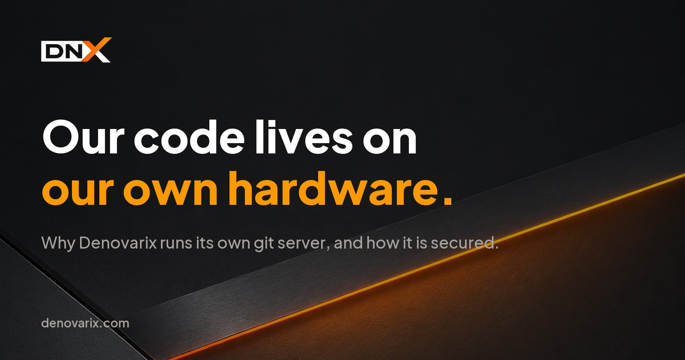

# Our code lives on our own hardware

*Sourav De, founder, Denovarix Technologies LLP. November 2026.*

We are building DNX OS, a business operating system, in India. We tell our customers one thing again and again: your company's data should sit on machines you own.

At some point I looked at where our own source code was sitting. It was not on machines we own.

So we fixed that. The source for DNX OS now lives on a git server we wrote ourselves, on hardware in our own office. This note is about why, and exactly how it is secured. No marketing. What it does, and what it does not do yet.

## Why not just keep using a hosted service?

Hosted git is good. We still use GitHub for public things like this note.

But the product source is the company. If I ask a bank or a government office to trust an operating system, I should be able to tell them where every line of it is stored, who can reach it, and that the answer does not depend on someone else's account, pricing or policy.

It is also a test of our own claim. If a small company in West Bengal cannot run its own git, we should not be selling "own your stack" to anyone.

## What we built

Two small pieces. Both are a few hundred lines we can read end to end.

1. **Push and pull over SSH**, with a key that can do nothing else.
2. **A web view** for browsing repositories, files, history, commits and diffs.

The repositories sit on a drive we own, in a folder only one account can read.

## How it is secured

### The git key cannot open a shell

The SSH key used for git is locked to one command on the server. With that key you can push and pull repositories. You cannot get a shell, forward a port, or open a terminal. If the key leaked, the damage stops at the repositories it can reach.

Repository names are checked against a strict pattern before anything touches the disk: lowercase letters, digits, a dash or underscore. No dots at the start, no `..`, nothing that can walk out of the folder.

Every push is checked for corrupt or malformed objects before it is accepted.

### The web view asks for the password, every time

- Every page and every API call needs sign-in. There is no public page.
- The password is stored as a slow salted hash, in a file only the service account can read.
- Sessions are random cookies that scripts cannot read and other sites cannot send.
- Any request that changes something needs a custom header that a cross-site form cannot add.

### Guessing is slow and capped

Five wrong passwords lock that address for five minutes. The attempt is counted *before* the password is checked, so firing many guesses in parallel does not slip extra ones through. For IPv6 the lock covers the whole /64, so hopping addresses inside one network does not help.

### Nothing the user types becomes a command

git is always run with an argument list, never through a shell. Branch names and paths are validated first. A branch name is resolved to a commit id, and paths are passed after that id, so nothing typed into the address bar can turn into a git option.

### It protects itself from being overloaded

- Silent or slow clients are dropped.
- Connections are capped.
- No git output is read past a fixed size, so one huge file or diff cannot fill the memory.

### The service is boxed in

The web view runs as an ordinary account, not as root. The system around it is read-only to that service: it can write to the repositories folder and its own config folder, and nowhere else. It cannot gain new privileges.

### It only answers to names we chose

The server answers requests addressed to its own address or to names we list. A web page somewhere else cannot trick a browser into talking to it under a different name.

### It is not on the public internet

The server is reachable on our private network only. It supports HTTPS with our own certificate.

## What it does not do yet

I would rather say this than have someone assume.

- **One owner account.** Per-person accounts and roles come with our own sign-in service, which is being built.
- **No outside security review yet.** We wrote it carefully and it has self-checks, but nobody independent has attacked it. That review is on our list before we recommend this setup to a customer.
- **No pull requests or issue tracker.** It stores, shows and compares code. Review happens in our own tools.
- **Backups are our job now.** Owning the hardware means owning the backup. That is the real cost of this choice, and it is fair to say so.

## Would I recommend this to every company?

No. If you have three developers and no one who enjoys running servers, a hosted service with two-factor sign-in is the right answer.

Do it yourself when the code is the business, when you sell trust, or when you need to answer "where is it stored?" with one sentence.

For us, all three are true.

## The same idea, in the product

This is the same rule DNX OS follows for our customers:

- AI that runs on the PC, so questions and files stay there.
- Full-disk encryption switched on at install.
- [AFRT](https://github.com/Denovarix/afrt), which adapts to how you work by counting, never by reading.

DNX OS opens its beta in December 2026: https://denovarix.com/beta/

---

© 2026 Denovarix Technologies LLP. https://denovarix.com
